# AWS Multi-Region Disaster Recovery Architecture

A warm-standby disaster recovery setup on AWS. An application runs in a **primary region (US East - N. Virginia)** and a **recovery region (US West - Oregon)**. Data is replicated between the regions, the primary's health is monitored continuously, and the recovery region takes over if the primary fails.

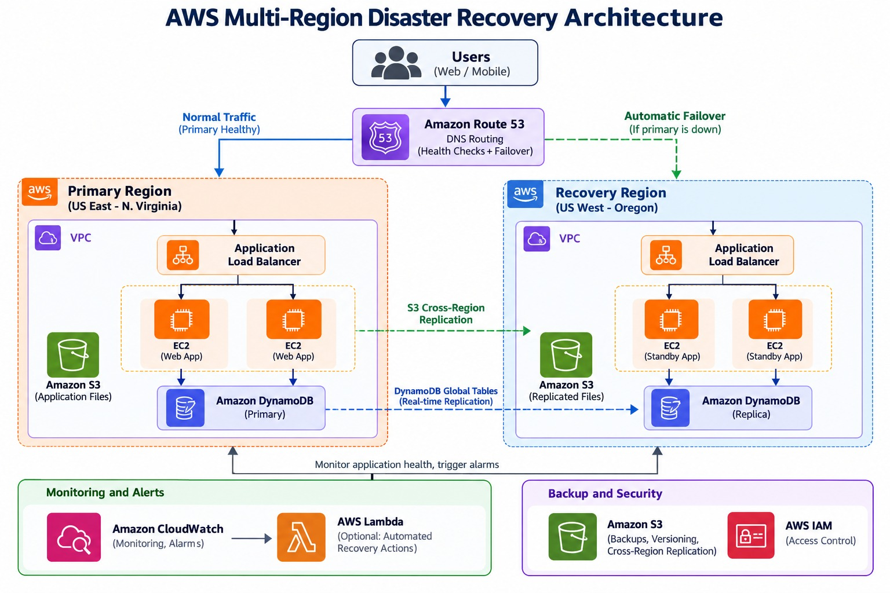

## Problem
An application hosted in a single AWS region becomes unavailable if that region has an outage, and its data may be unreachable. This project keeps the application and its data available across a regional failure.

## Architecture

| Component | Purpose |
|---|---|
| Amazon Route 53 | DNS routing and health checks; failover routing redirects users to the recovery region when the primary is unhealthy |
| Application Load Balancer | Distributes traffic across EC2 instances in each region |
| EC2 + Auto Scaling | Web servers (2 in primary, 1+ warm standby in recovery) built from a launch template and User Data |
| DynamoDB Global Tables | Multi-region, near real-time database replication |
| S3 Cross-Region Replication | Replicates files from the primary bucket to the recovery bucket (versioning enabled) |
| CloudWatch + SNS | Alarm on the health check and email alerts |
| AWS Lambda (optional) | Automated recovery action, e.g. scaling up the standby Auto Scaling Group |
| IAM | Access control, including the S3 replication role |

The design is **stateless**: no important data lives only on an EC2 instance. Servers are rebuilt automatically from the launch template, and data lives in DynamoDB and S3.

## Implementation (AWS Console)

1. **DynamoDB:** table `DRDemoTable` (partition key `id`, on-demand) in us-east-1, plus a Global Tables replica in us-west-2.
2. **S3:** versioned buckets in both regions, with a replication rule from the primary to the recovery bucket.
3. **Primary web tier (us-east-1):** security groups, launch template (`scripts/user-data.sh`), target group (health path `/health`), ALB, Auto Scaling Group (desired 2).
4. **Recovery web tier (us-west-2):** the same setup, with the Auto Scaling Group at desired 1 (warm standby).
5. **Monitoring:** Route 53 health check on the primary ALB `/health`, a CloudWatch alarm on `HealthCheckStatus`, and an SNS email topic.
6. **Failover test:** scale the primary Auto Scaling Group to 0 and observe detection and recovery.

## Test results

| Test | Result |
|---|---|
| DynamoDB item written in one region | Appears in the other region |
| File uploaded to the primary S3 bucket | Replicated to the recovery bucket (status COMPLETED) |
| Primary ALB | Serves pages from servers in both availability zones |
| Primary servers removed | ALB returns 503, health check turns Unhealthy, alarm fires, email received |
| During the outage | Recovery region keeps serving, with all data intact |

Screenshots are in `docs/screenshots/` and shown below.

## Why Route 53 DNS failover records were not implemented

The architecture diagram shows Route 53 automatically redirecting users to the recovery region. In this implementation, the Route 53 **health check** was built and tested, but the **DNS failover records** were not created. The reasons:

1. **Failover records need a domain name.** Route 53 failover routing works by changing the DNS answer for a name in a hosted zone (for example `app.example.com`). Without a domain, there is no name to attach the Primary and Secondary records to.
2. **A load balancer address cannot be used instead.** Each ALB address (`*.elb.amazonaws.com`) belongs to one region and always points to that region's load balancer, so it never redirects to another region.
3. **No domain was registered for this project.** Registering one costs money (a few dollars per year) and can take time to become active, which was not needed to validate the rest of the design.

**What was verified instead:**
- The Route 53 health check on the primary ALB (`/health`) correctly reports Healthy and turns Unhealthy when the primary servers are removed.
- The CloudWatch alarm fires and an SNS email is sent.
- The recovery region keeps serving the application, and its replicated data (DynamoDB and S3) is intact. The Oregon ALB was opened manually to show the takeover.

**What a domain would add:** two failover records under the domain would make the redirect automatic:
- a **Primary** alias record pointing to the Virginia ALB, with the health check attached
- a **Secondary** alias record pointing to the Oregon ALB

Route 53 would then return the Oregon ALB automatically once the health check marks the primary Unhealthy. Expected switch time is about 2 to 4 minutes (about 90 seconds for detection plus the DNS TTL).

## Screenshots

### Data replication
DynamoDB table `DRDemoTable` in the primary region and its replica in Oregon, showing the same items:

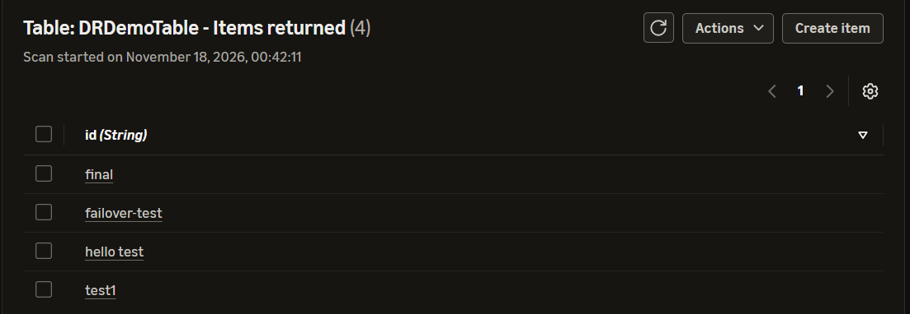
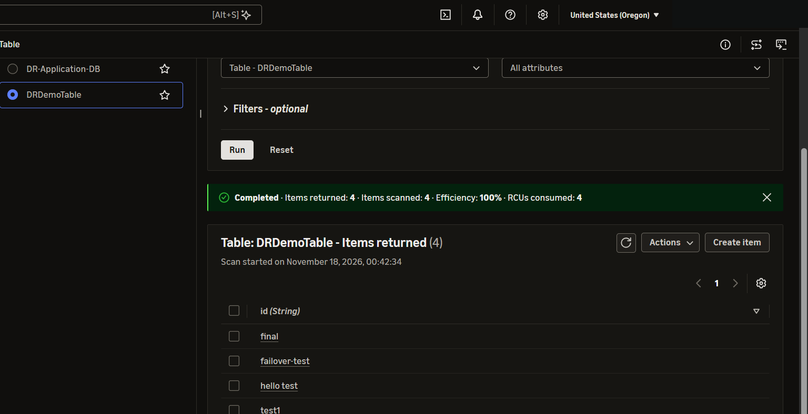

S3 primary bucket and the replicated bucket in Oregon, showing the same objects:

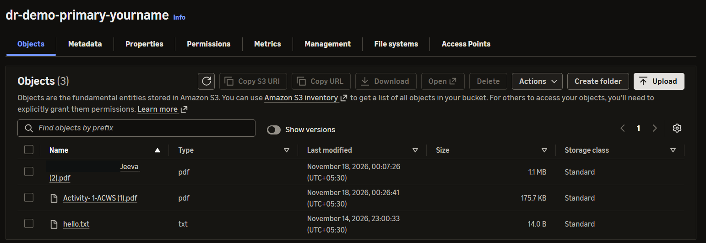
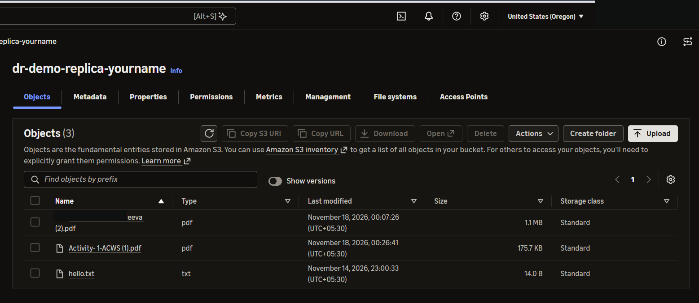

### Primary region (N. Virginia)
Load balancer, and pages served by two servers in different availability zones:

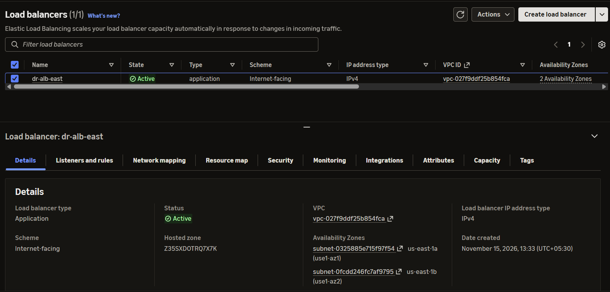
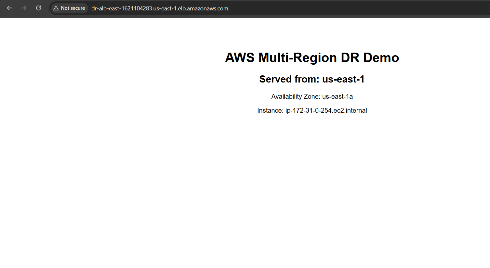
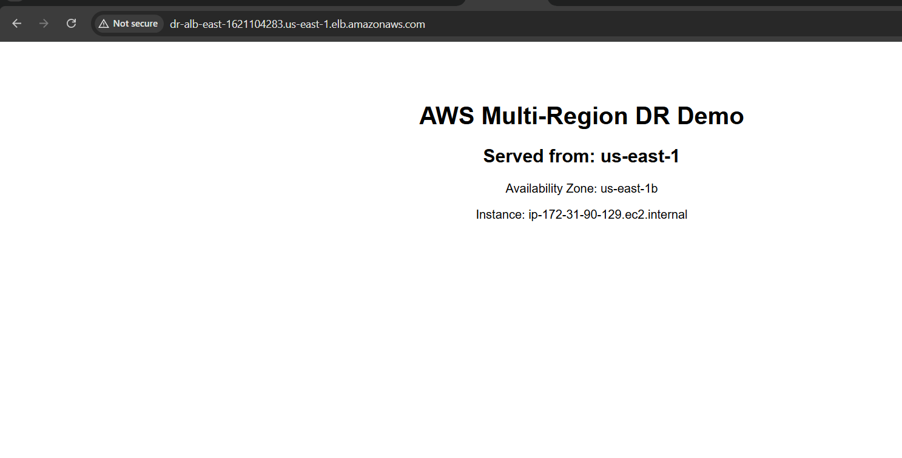

### Recovery region (Oregon)
Load balancer, standby servers, healthy targets and the pages served:

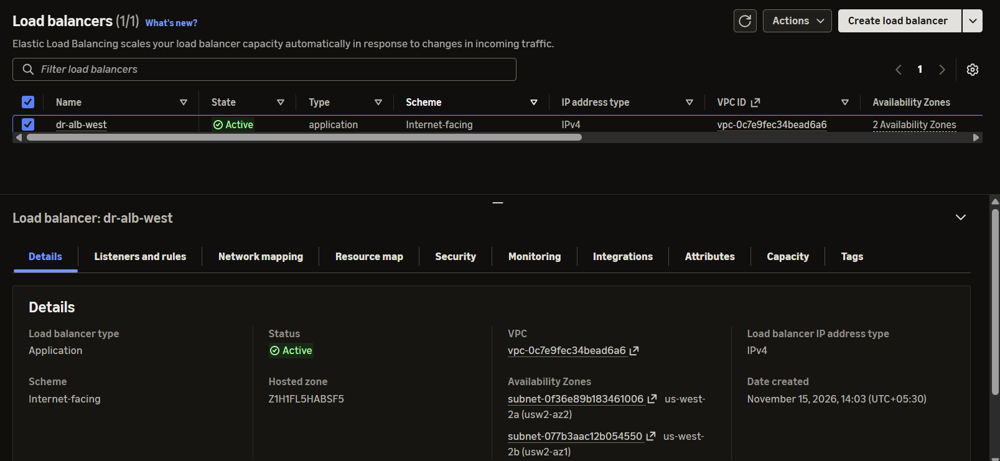
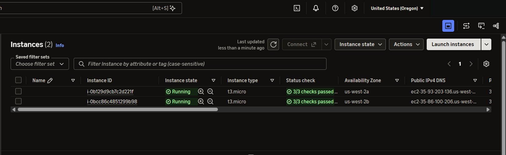
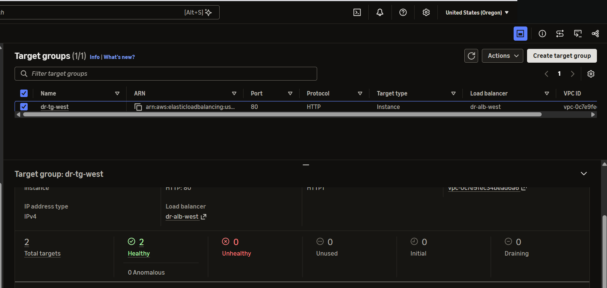
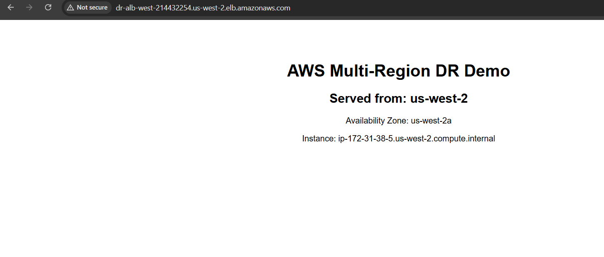
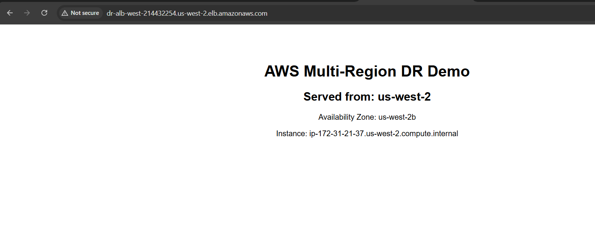

### Monitoring
Route 53 health check on the primary load balancer (`/health`, port 80):

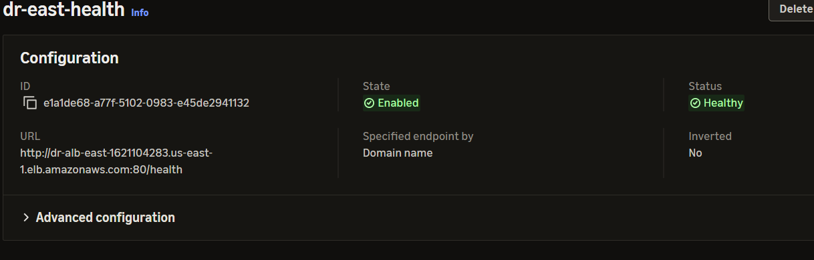

### Failover test and recovery
Primary Auto Scaling Group set to zero instances to simulate a primary region outage:

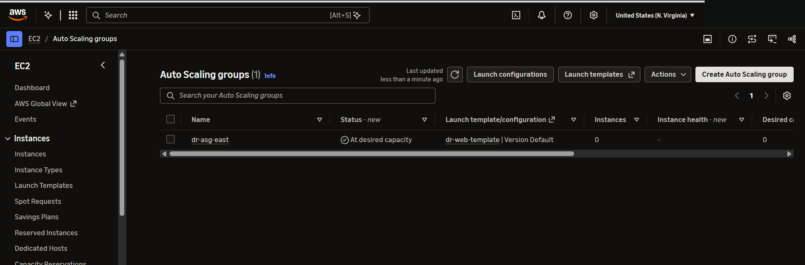

After the test, the primary was restored. The instance list shows the earlier servers terminated and new ones running, and the page is served again from us-east-1:

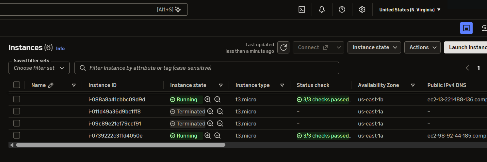
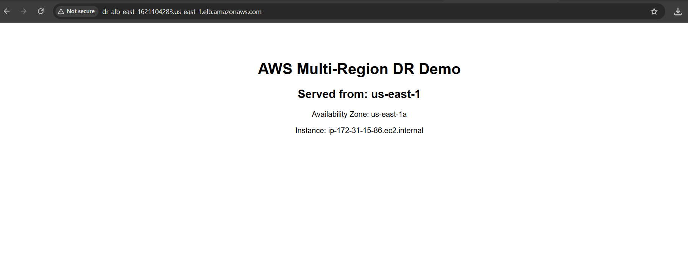

## Recovery objectives
- **RTO:** a few minutes (health check detection plus DNS TTL)
- **RPO:** seconds (near real-time replication)

## Infrastructure as Code (Terraform)

The same architecture is also provided as Terraform code in [`terraform/`](terraform/), with an optional recovery Lambda and optional Route 53 failover records for users who own a domain. See [`terraform/README.md`](terraform/README.md) for usage.

```bash
cd terraform
cp terraform.tfvars.example terraform.tfvars   # set alert_email
terraform init
terraform plan
terraform apply
```

## Future enhancements
- Register a domain and add the Route 53 failover records
- Lambda function triggered by the alarm to scale up the recovery Auto Scaling Group
- HTTPS with ACM certificates in both regions
- EC2 instance roles for DynamoDB and S3 access
- AWS Backup with cross-region copy
- Run the Terraform in a CI/CD pipeline

## Repository structure
```
.
├── README.md
├── scripts/user-data.sh      # EC2 User Data (Apache + region page + /health)
├── terraform/                # Infrastructure as Code for the same architecture
├── docs/
│   ├── architecture.jpg
│   ├── cleanup.md
│   └── screenshots/
└── .gitignore
```

## Cleanup
See [docs/cleanup.md](docs/cleanup.md). Load balancers and EC2 instances incur charges while they exist.


